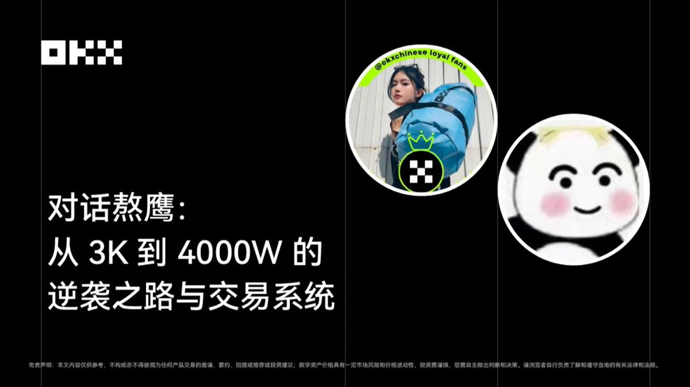

# 从 3K 到 4000 万，一文带你了解传奇交易员——熬鹰

> 📅 **日期**：2025-06-24  
> 🎙️ **来源**：OKX VIP《对话交易员》第一期（@mia_okx）  
> 🔗 **原文链接**：https://x.com/mia_okx/article/1937440133642613066

---

他曾是负债累累的Degen，在“20万魔咒”中反复爆仓；如今却能多次靠单币实现百万美金利润，年度收益超4000万

他三度登顶交易所带单榜首，用实盘创造车头神话：20000%收益率｜单币盈利140万U｜跟随者盈利180万

本期专访传奇交易员熬鹰 @thankUcrypto

一起拆解这位“交易流量圣体”背后的实盘操作与交易方法

这是《对话交易员》系列第一期，采访人 @mia_okx ，欢迎关注～

👇 以下是对话全文的精彩内容，视频/文字内容都帮大家整理好了，欢迎观看

> 没有裸辞，靠OKX带单三倍收益杀进Web3

熬鹰：“我之前是做互联网产品的，2020年因工作需要接触到Web3，并在2021年开始做期货交易（合约）。刚开始的本金很少，一个月一万多工资，能拿出来三五千人民币来做交易。后来一直交易并投入，当时的结果就是有亏有赚，最后还是亏的比较多。刚进入Web3时候没有辞职，还换过一份工作。我当时事业和生活上都遇到了瓶颈，感受到经济压力，比如作为男人该承担的责任“买房买车，给女朋友更好的生活”，所以需要一份副业，那个时候还没有完全想要投入进去，那会自己也才二十四五岁，但会开始往这个方向转，直到做了一个比较好的成绩吧：我在 OKX 上用 “all in crypto” 这个带单号，半年时间实现了三倍收益，回撤也非常低，并因此收获了第一批粉丝。从那时候起，我就辞职开始独立做交易，一路走到现在。相当于说，OKX带单功能给了我“第一次机遇”，让我被更多用户看到了。”

> 零基础小白阶段，去学习实盘“大盈利”交易员

熬鹰：“每个人学习Web3的路径是不一样的。我比较“野路子”，绝大多数的人，可能会去系统性的学习各种技术性的指标,、或者怎么看盘、怎么看K线，而我就是在各种实盘软件里看真实交易员的单子， 去结识他们，想尽办法加他们的粉丝群、然后请教他们单子的逻辑。就是尽量去结交那些实盘大盈利、又愿意分享的交易员，好好地向他们学习。其实从他们那里学到的，并不是一套系统性的方法论，而是能帮你少走很多弯路、少亏很多钱。我当时就是这样，一直按图索骥，持续看真实交易员的分享和实盘操作，向他们请教每一笔交易是怎么做的，为什么能赚、为什么会亏。就这样，一点点摸索，再结合自己不断实盘、多亏钱，慢慢就“亏”出了经验。没有什么特别成体系的学习路径，就是靠模仿优秀交易员、不断交流，再去反复实践。”

> 从 0 到 100 万，是抓住了行情，也是“亏醒”的

熬鹰：“我可以从几千块钱做到十几万到几十万，但当时就是到了一个心理或者说资金门槛，就上不去了。后来那一波能做起来，其实还是因为我抓住了2024年的一波行情——说真的，就是运气。2024年三月到六月之间，其实出了两波行情，一波是 AI 行情，一波是模因币的行情，我刚好都抓住了。然后在启动前，我还踩到了铭文的“第二春”那一波，基本上三波行情都吃到了，就让我一下突破了资金上限。当时我负债基本上还清了，同时还有点利润，从那以后就可以一直做下去了。所以我觉得，所谓的资金门槛，其实很多时候不是靠学习交易突破的，它更像是心理层面的——不是你指标没学好、盯盘不够努力、不会选币，而是你性格、你心态还没到位。

如何调整负债阶段的心态，不影响操作？这个说起来有点像“马后炮”。实际上，这个东西真的没什么办法，大家都是靠硬熬。绝大多数的大额亏损，说到底，还是因为你不愿止损。我当时在负债那个阶段，交易已经变形了，才会越来越“水下”。所以说我就是亏得还不够痛——尽管已经亏了很多钱、很多单子，很多是价值特别高的单子，甚至做到几十万又亏回去，其实就是不好好执行自己的交易，就是亏的不够痛。直到我亏到最后、实在不能再亏了，再亏真的就什么都没了，那时候才是真的“亏痛了”，就解决所有问题了。我开始非常谨慎地对待每一笔交易，每一单都老老实实去执行，盯盘的时间非常长。我有一个交易习惯，就是“开单的时候不睡觉”，甚至最多可以熬40～50多个小时。遇到大行情的时候，我会去熬，行情结束，我睡一天也没问题。所以，我会盯着每一笔钱，厌恶波动，厌恶反向波动，但同时又有很好的感觉，所以。能做起来可能和自己的个人经验有关 。”

> 在“20万魔咒”中反复爆仓后，学会了资金管理

熬鹰：“关于“多次做到20万结果，又还回去”这件事，如果是系统性学过一些分析方法的人，可能会对每一单有明确的止盈止损。但我自己的交易方式不是这样，我是比较跟随行情的——我开单虽然有止损，但有时候就是克服不了人性，会把止损撤掉。我估计每一个交易员都会有这种情况：行情已经反向了，但还是想扛单。我以前也改不了这个坏习惯，直到亏得差不多了，亏得“屁股尿流”、眼眶都湿了，才真正改变。

亏到那种程度之后，我的每一笔交易都开始符合自己的心态了——不能再亏了，再亏就什么都没有了。我每一单都开始非常谨慎地执行，盯盘盯得很细，开始好好做每一笔交易。说到底，最终还是资金管理的问题。尤其是小资金阶段，每一单都要严格止损。到了我现在这个阶段，我其实不设止损了，但我能安稳地应对，是因为我已经提了一大半了，心态稳定了。如果你账户里是一两千万，那你的操作可能会积极一点点，但前提是你已经走到这一步了。反过来说，小资金特别是处在负债、“水下”的时候，能做的就是认真对待每一笔开单、每一笔平仓，好好抓住行情。如果是趋势行情，就拿住；如果是波段行情，比如现在是震荡行情，到底就平仓。其实交易很简单，没那么难。”

> 公开“开单逻辑”：基本抛弃各种指标，靠认知才能赚大钱

熬鹰：“我现在偏事件交易会多一点。也就是说，我下单之前不是纯看K线的。说得直白一点，我会先想清楚当前这段时间的行情是怎样的，然后在这个行情里面我该怎么做日内波段，我会判断当前是在高位还是低位。如果行情是事件驱动，我会判断这个事件是否可持续。如果不可持续，到了关键位置我就会开空。因为现在是震荡行情，高空低多的策略比较有效，只有“傻子”会在震荡行情里亏大钱，所以说我们现在赚的是“傻子钱”。但一旦出现趋势行情，那我就可能开始亏钱了。所以我现在其实在赌“跌破”。

具体交易方法方面，我也可以说说。我在早期的时候，我学会任何一个人追求的交易方法，比如双均线系统、EMA看均线、裸K、斐波那契、波浪理论、道氏理论、还有各种海龟法则等等，几乎都研究过，这些弯路我都走过。但到现在，这些方法基本用不到了。除了裸K、均线，还有交易量看看，其它指标我都不会再用了。我们毕竟不是数学家，没必要太钻进那些指标里面。虽然我们最后是在盘面上看概率，但真正能赚大钱的，还是要靠自己的认知。指标只能让你点位开得更好一点，但它决定不了你最后能不能赚大钱。所以我现在基本上抛弃各种指标了，它们可能还挂在图表上，但我不会用它们来做真正的技术分析。

比如你说看到行情到了布林带上轨，就觉得要要跌了，但你去看各种指标跑回测的数据，在特定行情下它们的胜率可能超过55%，但非特定行情下远低于55%，甚至更低。举个例子，现在比特币处于震荡行情，布林带或许还能用，但换成趋势行情就完全不好用了。所以说，别太迷信指标。我是完全不迷信指标。我自己踩过各种各样的多坑，曾经我也以为找到了高胜率的策略，或者说“交易圣杯”，但最后发现这些东西都是假的，只有自己的认知是真的。刚好最近这段行情，比如ETH上涨、模因币上涨，以及后来的ETH震荡、BTC震荡，都在我的认知之内，所以我能赚钱。说到底，交易就是一门认知的生意。我已经把我全部的交易感受讲给你们了。

在迷信指标的过程中，我也亏过不少钱。我总是想在几个指标重叠时提升胜率，甚至想要达到90%的准确率，但往往就是在这种重仓的时候亏光了本金。不过我要说的是，不迷信指标，并不等于指标无用。该学的还是要学。因为指标本质上是数据化的情绪。我们用盘感、看裸K、看各种走法，其实也都是在观察市场情绪。你看的指标越多，理解得越深，你对市场的理解自然就越全面。但了解市场，并不等于你能赚钱。最终还是看你自己个性、性格，或者说胆子够不够大。比如，你敢不敢拿出几百万本金，顺着市场去操作？很多人不敢，这就是风险偏好的问题。有些人风险偏好低，能赚大钱的机会也就少，但亏得也不多。”

> 提升认知就是靠“亏钱”

熬鹰：“如何提升自己的认知，才能有效判断市场？如果是私下里聊，我会直接跟你们说：多亏钱。亏得够痛了，认知自然就到位了。你每一个坑都没有白踩。在交易过程中，可能你因为某些止损没做好，点位没挂好，或者把突破行情做成了震荡，这些都是常见情况。但只要你因此亏过大钱，那这些教训就会牢牢记住，成为你认知的一部分。

这些年我们不断在市场里汲取新的信息、新的规则。我们在小白的时候，根本不懂什么叫炒小市值，不懂资金费率怎么看，更别提指数价格和标的价格之间出现很高的正溢价、负溢价，我们连这些都不知道是怎么回事。但只要你在市场待了一定年限，盯盘盯得够多，亏得够多，这些东西自然都会变成你的认知。这就是所谓的“到了年限，自然就懂了”。所以，你需要有一个比较好的内容汲取渠道，建立起自己的信息汲取系统。然后在交易中多总结、多记录。说白话点就是：交易的时候多盯盘、多亏钱，记住亏钱带来的教训。如果记不住，那你就写下来，记交易日记也好、做复盘也好，一定要“亏痛了”，本能性记忆就不会再犯这些错误了。这就是我提升认知的方法。

关于如何感知市场情绪的？以及哪些方式收集信息、判断市场？首先肯定是图表，图表是第一要素，价格涨跌的直观表现。第二就是事件交易。其实我这一轮大收益，基本都是靠事件驱动做出来的。比如说依靠“特朗普与马斯克互掐”的宏观事件，我赚到了第一个100万U的单子，当时我们注意到美股那边几个核心科技股，像特斯拉开始钻地了，先是跌5个点，然后开始向8个点、10个点跌。而币圈那时候还没动，我们就借着这个信号，做了DOGE的跌破空单。当时是在一个很低的位置开空，DOGE跌破之后又砸了10个点，这一笔让我赚了大约100多万美金。后面BTC跌到10万附近横了一阵，开始反弹，我又感觉这波应该到底了，于是顺势抄了ETH的底。所以，“特朗普与马斯克互掐”事件是导火索，让我开了这两单，一个跌破单，一个抄底单，所以说这就是情绪的运用。再比如其他的技术指标，盘面上可以从图表上抓一些形态组合。我说的不是那种两三根K线的形态，而是你观察周期的一段行情组合，比如你做的是一小时级别，那你应该关注的是这一个小时图里十几二十根、甚至五十根K线形成的组合走势。你要看这段行情整体是偏强还是偏弱，再结合自己的主观判断，去判断震荡行情是否是尾声。如果是尾声，可以做突破单，如果不是尾声，那就继续用高抛低吸的方式做。”

> 怎么判断一个币是否值得买入？开单逻辑怎么定？

熬鹰：“资金量上来之后，玩法自然会发生变化。所以我分两部分来说。

当我在做小币、小市值山寨，或者一些偏冷门主流币时，我最看重的是热度——有没有热点事件驱动，有没有足够的吸引力。这轮行情里，我最初的小资金，其实就是靠这些小币做起来的。很多人只看到我“ETH做多赚130万U”“BTC做空赚100万U”这些操作，其实那只是资金量变大后，顺势吃个20%-30%的结果。真正起量，是从抓住小市值币爆发开始的。

比如，ETH那轮，连续涨了四天，总涨幅接近80%。在第三天的时候，我开始关注一些相关联的山寨，比如河马（Homer）——那时它刚启动。第一天涨了100%，第二天回调十几个点，我就选择做多。换做平时，一个币前一天涨一倍，第二天没人敢追。但当时ETH连续上涨，市场情绪非常亢奋。如果ETH只是涨10%-15%，我也不敢碰这些山寨。ETH涨太快，很多人根本没来得及上车。等到周末盘整，大家手里有钱，焦虑错过，于是自然冲进那些还没启动的币。我抓住的，就是这种“错过的情绪”。

我们挑的币也有讲究，必须是成交量大、换手率高、市场最热的。河马当时正是最热的那一批。我靠这波河马，从100多万做到500多万，9单没有一单亏损，净赚400多万。这些操作，并不是靠指标。我可能会参考下均线位置，但不会特别依赖。很多人复盘我交易，觉得我开单很精准，其实关键在于：我对项目、对市场节奏、对情绪的判断，这些认知才是核心。再比如，河马的空单操作：它拉了三轮顶部，第四天还没上线大所，我判断行情差不多了就开空，几个小时后开始暴跌。我知道短期内它不太可能再上线大所，所以顺势做空。这并不是图形判断，而是基于对“上币规律”的认知。

还有PEOPLE，我看到它日线级别快突破新高，就提前点火。一些KOL发现是我推动的，立刻做空当对手盘，反而成了我的燃料，被继续爆掉。我又吃了一轮行情。我做交易从不割粉丝的流动性。即使我知道顶部快到了，也不会直接砸盘，而是等行情稍微回落后慢慢平仓。我会给粉丝足够的时间和空间做决策。我带粉丝赚了钱，大家信任我，自然让我有了影响力。所以，你问我的开单逻辑、平仓逻辑、开空逻辑，其实都不复杂。我不会特别依赖某个指标，顶多看看盘是不是到了关键位置，比如前高、新高、是否突破或者跌破等形态。这是我做山寨时的参考标准。

但做大饼和以太就完全不一样了。我做BTC和ETH，基本是顺着行情操作。如果遇到震荡行情，会在关键位置结合价格行为观察，有时也会参考部分指标，但它们对我的决策影响很小。真正影响我决策的，始终是我自身的综合素质，比如当时的心态和操作环境。如果只是单纯去看我的交割单，其实看不出什么核心内容。很多做量化的老师会出视频复盘我的交易，说我有某种特别的交易系统，但这些说法并不准确。我没有所谓的系统，我甚至不太理解“交易系统”到底指什么。我的交易方式，核心是逻辑判断和认知判断，而不是依赖图表或K线。那种“画一根趋势线，突破了就开单”的方式，我个人是不认可的。当然，比特币和以太坊我偶尔也会看图表，但在整体交易体系中，它们的权重非常低。”

> 关于买卖点、仓位管理

熬鹰：“关于买卖点，比如止盈止损，我会灵活应对。比如在震荡区间，可以用前高、新高作为止盈止损点；也可以参考日线级别的均线压力位，如MA30、MA120等；或者画一根趋势线，跌破即止损。还有一种是“移动止损”：当你已经有盈利，又不希望回吐利润时，可以设定回撤阈值。例如盈利20%，若回撤到15%就自动止盈，这适合风险偏好较低的人。但我不是这样。如果是做突破策略，我通常会等到价格跌回成本才止损。因为如果连成本都被跌破，说明行情可能已经转向，而我又不是开得很差，这时候我会考虑离场。每个人的止损风格都不一样。我的止损就是“全面止损”，也就是说，我有各种各样的止损方式，要看行情、看开仓位置、看我当时是做跌破、震荡、还是突破。这些东西全都是随机应变的。我的交易没有系统，我的交易是完全随机应变的。我可以做任何行情，也可以有任何种类的止损方式。这也是为什么很多人看不懂我的止损逻辑。有时我自己回看交割单，也很难复盘出当时的理由，可能还要结合当时的情绪和市场事件。

关于仓位管理和杠杆。很多人看到我交易单上的杠杆是10倍，其实那只是表面数据。因为我在行情中会提取一部分资金，所以即使名义上是10倍，实际杠杆只有大约5倍。而且我不会一次性满仓开完，而是逐步建仓，所以实际操作下来，大概是4.5倍杠杆。虽然你看到的是10倍、满仓，但我自己很稳，因为账户里还有大量可动用的资金。

以5倍杠杆做BTC或ETH，其实风险并不大，尤其我是做日内交易的。现在大饼的日波动区间大概是2%-5%，我能承受住盘口波动，行情一不对就及时撤退，几乎没有太大回撤。最大一笔回撤是在ETH涨了两个点时，亏了90万U，不过这些亏损后来基本都找回来了。就算找不回来，也只是交易过程的一部分。

对于很多人来说，他们构建自己的交易系统、看重每一笔交易和执行力的确没问题。但对我来说不是，我是靠逻辑交易的，所以当时的逻辑才是最重要的，不是什么“KDJ金叉了”、“布林带突破上轨了”、“MA踩到了MA30”，这些只是某一个参照物，而在交易过程中我们可能会有 100 个参照物，最后会被我们综合输入到大脑，再结合自己的交易风格、交易性格去做决策。养成一个适合自己的交易习惯与交易性格，才是能否赚到大钱的核心。”

> 让资金滚动起来，并不取决于杠杆倍数

熬鹰：“老粉丝应该知道，我第一笔单子是开了五倍杠杆做多BCH。时间是在2024年3月，但要追溯起因，其实得从2024年2月讲起。我观察市场动向，发现BSV开始异动——BSV背后是比特币网络早期的核心开发者，很多技术人员都出身于此。BSV当时先涨了30%，随后一路飙升至50%。我看BCH走势也不错，就判断它可能会补涨。虽然BCH流通盘更大，但在BSV已经涨成那样的情况下，BCH怎么也该来一波。于是我进了多单，用了五倍杠杆。BCH两天涨了80%，我没吃满，大概吃了2.7倍，账户净值涨了40%以上，那一单直接让我从3000多U做到了1万多U，是我交易生涯里最记忆深刻的一笔。

之后行情开始顺了。AI赛道和MEME轮番起飞，我接着做Watercoin，再做PEPE，那段时间行情非常配合Watercoin启动后，PEPE一周内也起飞，AI和MEME板块彻底爆发。Watercoin最猛的时候，FDV甚至接近以太坊和Solana。

我也会参考BTC的走势。比如从2024年3月到8月，大盘处于震荡期，每次BTC触及日线级别趋势线压力位，我就做空；而到了底部，我不会直接去接BTC，而是选择一些优质山寨币做多，像AI币或MEME币。也是因此，我会关注各种汇率对走势，判断BTC表现后，再决定买什么。

说到杠杆，除了BCH那一单是五倍，我之后基本都用三倍、两倍，甚至一倍，实际杠杆就是这些。因为山寨币波动非常大，比如Watercoin日内波动能达到20%，我日内做四五单，其中三四单都能踩准，胜率大概在61%左右，手续费基本能覆盖掉。也正因为这样的节奏，后面我的杠杆反而越用越小。

从500U做到800万，有一笔关键操作是CRV那一单。当时CRV创始人链上套现，传出清算风险。我人在泰国，正在游艇上准备潜水，看到推特有人爆料，我马上意识到有机会。那时主流媒体还没报道，我直接用代单账号两倍杠杆开空，CRV一根K线下跌20%，破历史新低。我看到下不去了就平掉空单，反手做多，又吃了20%的反弹，这一来一回直接赚了300多万。当然，这其中也有运气成分。要是CRV像LUNA一样暴雷，那我反手多可能就被反杀了。但这次判断比较准确：如果价格止跌，要么是清算完了，要么是创始人补了保证金。后来证明他确实去OTC卖币融资了，所以我也成功抓住了这波反弹。

总结来看，除了BCH那一单用了五倍杠杆，其他基本都是4、3、2、1倍，甚至到0.8、0.5倍。整个周期其实不长，我从2月26日开始操作，到7月10日结束，大约四到五个月时间，从2万U做到1000万。虽然过程不轻松，但如果方向踩得准、逻辑判断正确、不犯致命错误，其实在短时间内是可以实现极大突破的。你也可以做到类似节奏。关键是方向准确，逻辑清晰，同时避免大错，比如逆势做空、死扛单这种操作。只要规避致命错误，再加上敢于复利，就有可能实现突破。

虽然后期我用的杠杆只有一倍、两倍，但那时的资金量已经远不是最初的量级了。一开始两万块开五倍，也就十万名义仓位；但等我做到五百万，就算只用两倍杠杆，也已经是千万级别仓位了。所以后期不能只看杠杆倍数来判断风险。对我来说，用两倍杠杆做一个山寨币的心理压力，甚至远远大过当初用两万块开五倍做BCH——资金量变大后，哪怕倍数低，压力也会显著提升。

在小资金阶段，很多人会纠结“是搏一把还是稳扎稳打”，其实这不需要太纠结。更重要的是养成一套适合自己的交易习惯和风格。如果这个习惯是对的，就能长期延续，它就是你自己的交易逻辑。

我建议大家实际杠杆最好不要超过五倍。就像我自己在那一轮，从头到尾实际杠杆基本没有超过五倍。老粉丝都知道，除了BCH那一单，我后面所有操作杠杆都控制在五倍以内。这里还有个题外话：我并不是刻意去限制杠杆，而是我代单用的平台对山寨币本身就有限制，最高只能开到五倍杠杆。算是一个“被动限制”，但结果很好，反而让我在整个周期越做越低倍，越低倍反而赚得越多。越低倍，越敢拿、越稳得住。亏的时候敢止损，赚的时候敢持有，从而形成了正向循环。慢慢地，杠杆越来越小，盈利越来越多。

所以总结来说，从最初的五倍杠杆开始，逐步降到三倍、两倍、一倍甚至更低。真正让资金滚动起来的是逻辑、策略和执行力，而不是用了多高的杠杆。举个例子：两万块开五倍是十万名义仓位；做到十万U时我可能只用两倍；一百万时用三倍；五百万时再用两倍。杠杆在变小，但资金在复利。到最后，真正拉开差距的是认知，而不是杠杆倍数。”

> “反直觉”入场点位

熬鹰：“我之前也提到过，很多人其实不了解我的交易逻辑，因为我并不是靠技术指标判断。我很多时候是基于事件驱动，或在某些特定环境下做出判断。比如，有些时候我观察到某个板块突然活跃，那我可能就会去“炒板块”或“炒事件”，或者用自己的一套逻辑来判断。如果我觉得整体行情偏空，我会选一个本身已经跌得比较多的标的，在震荡区间里、还没出方向、也没有明显爆拉爆跌的时候，先行开空。这对我来说是非常正常的操作。很多人陷在图表里，看K线、画趋势线、找形态，就完全想不到我的这种玩法。因为我并不属于“图表派”。

还有人问我，说我做事件类、新闻类交易的反应速度特别快，是不是背后有什么情报系统？其实没有。我就是开个经济数据网站，挂着推特，给关注的人打开小铃铛提醒。仅此而已。当然，也有朋友送我一些工具，比如大额持仓变动提醒，我也会看，但这都不是关键。真正的关键是自己的临场反应能力。你能不能在第一时间发现事件，并迅速判断这个事件是否能影响接下来几天的价格走势——对我来说，“中长期”可能就是两三天。

现在的行情，大多数新闻出来，顶多影响一根15分钟K线，运气好点可能能带动两根1小时K。但在流动性好的时候，如果你能从独特角度去解读一个事件，并以此支撑你的交易方向，无论是做多还是做空，就能赚到。这就是所谓“事件交易”的核心：你得有第一反应能力。比如某天突然有新闻说“普京宣布比特币作为国家储备资产”，你一看就知道这是超级利好。这种消息一出来，直接暴拉50%都不奇怪。因为我们这个市场，情绪是最猛的。所以要靠自己去培养对事件的敏感度，并把这种敏感度转化为交易判断。

当你慢慢具备这种事件敏感度后，交易起来就会得心应手。因为很多时候，行情是“先有因后有果”；但也有时候是“先有果再找因”。比如盘面已经走出来了，价格跌了一波，大家事后再找原因，说可能是某个事件导致。但实际上，并不一定是事件引起的，可能只是情绪带动的自发行情。所以我们既要判断“事件引发行情”的情境，也要警惕“行情反过来带动事件解读”的情况。这两类我都会去观察、分析。

比如“门头沟交易所赔付事件”，市场就会反应剧烈，比特币一口气跌5%。但你冷静下来分析，这种事件并不可持续。跌完之后，它还会涨回来，所以我们也可以博这类的波动。

第一步，是保持对信息的敏感度；第二步，是多看、多练、多交易。这些全靠经验积累，我也没办法总结成什么公式或系统。

再举个例子，在2021年，很多项目只要换个名字，或者把代币分发机制改成1变10000，市场就当成利好炒起来，动辄翻倍、两倍甚至三倍。但到了2024年，你再搞这一套？大家都看穿了。换名字，是为了换合约地址，为了重新增发，然后再割一轮。聪明钱早就看明白了。以前一发公告，市场会冲进去买；现在再发，大家知道这是利空。这就是市场环境变了，事件交易的逻辑也随之变化。所以，“事件驱动交易”并不是一成不变的。它不是你吃透一次就能用一辈子的东西，而是需要不断跟着市场节奏去调整的东西。”

> 对后市、以及比特币价格的看法

熬鹰：“如果你们要问比特币，我可以说，我对比特币是永远看不空的。虽然在某些结构下我也会做空它，但从整体格局来看，大家也能看到——从 MicroStrategy 开始不断买入比特币，到现在美国很多机构每天都有净流入资金购入比特币，这种现象已经决定了比特币不会再出现那种超级暴跌的行情了。

在以往的牛熊转换中，不管是大周期牛熊，还是阶段性回调，幅度基本都在 25% 以上。但这轮行情，从 11 万美元跌到 7 万多美元，也只是刚刚达到过去“牛熊转换”的最低回调线。所以我个人感觉，比特币未来依旧有可能持续上涨，但这种上涨会是那种扭扭捏捏、涨得很“恶心”的节奏，不是从 1 万到 4 万、6 万那种一路暴拉的单边行情。

有句话怎么说来着？“涨幅都是跌出来的”。如果比特币没有一轮比较深度的回调，它的上涨节奏很可能就是震荡式的、消磨人性的。你做短线的，拿不住；你做长线的，就得不停给自己做思想建设，不断提醒自己：“各国政府在买、机构在买”，即使下跌，也得硬着头皮加仓，愿意继续买下去。所以我认为它会是一个长期的优势资产。

另外，只要特朗普还在位，我认为比特币不太可能出现特别大的深熊。从政策角度看也是如此。毕竟这是特朗普政府这些年力推的方向之一——加密市场，这注定是一个长期利好。所以你要问有没有熊市？我不敢说会有深熊，但如果是 25% 左右的回调，我认为今年肯定是有的，我现在也在等这样的回调。但等回调到了之后，我肯定还是会选择做多的。”

> 小白“翻身”建议

熬鹰：“如果是小资金、想翻身的朋友，我的建议是这样的：

如果你觉得自己比较聪明，也有能力去读懂项目、理解加密逻辑，那我建议你不要在二级市场上赌波动，而是直接参与项目建设。换句话说，不要老是想着靠币价波动赚钱，比如炒比特币、炒山寨币。这和你是“小白+小资金”的组合，完全是两个逻辑。如果你真的只是小白、小资金，那你就先尝试一小波大的操作，去测试自己的交易能力；但真正要放大仓位，还是得等自己资金变多、认知更成熟，对比特币、以太坊这些东西理解得比较透、对行情周期有概念之后，再去考虑加大操作规模。否则像我以前一样，以小搏大，结果行情走没了、又开高杠杆、又不懂风险控制，一下子亏得非常惨。负债套牢，那真的太痛了。那种情况，即使你再努力工作，靠工资去弥补也没法补回来。你可能一单一单亏个三五千，时间长了就发现，三五年都还不完。

所以我想说：

- 第一，不要负债做交易，这一点真的特别重要；

- 第二，小资金建议去多参与一级市场、参与项目本身的搭建，尤其是那些原生的区块链项目；

- 第三，通过这些方式先积累一定的本金和认知，再考虑去期货市场做“波段操作”。

当你有了认知，你自然就会降低杠杆，不再搞那些10倍、20倍的激进操作。你也会懂得去控制名义价值、控制风险。

这样就算亏，也亏不到哪里去；赚呢，也是在你认知范围内合理地赚。这其实就是我总结下来的建议吧。”

> 为什么很多努力学习的人还在亏钱

熬鹰：“怎么说呢，其实大家赚钱的路子真的不一样。虽然我们都说是Web3这个大领域，但里面分出来的赚钱路径是非常多的。就拿我们自己来说，我们是做期货的，在币圈叫合约交易嘛，其实本质上就是做期货。那我们在期货市场里面赚的钱，很多时候跟你学习什么课程、走什么路径，其实没有太大关系。

因为我认识的很多期货交易员，他们都是草莽杀出来的。有的人甚至比我以前更惨，但他赚得比我还多。这些人可能谈不上什么“认知体系”，也没有很强的学习能力，但他们身上一定有某个特别突出的闪光点——比如说执着，比如胆子大，或者盘感好。他们可能也没学多少，但交易上就是有自己的一套，比如特别擅长抓住一段行情，其他时候就管得住手，死守那一段。这类人就是靠这一段行情吃饭，其他时间能忍，行情来时敢搏。他们有他们自己的风格，能赚钱就足够了。

所以说，很多人亏钱，不一定是“学习路径错了”，这和路径对不对没太大关系。特别是在期货这种高波动、高放大的市场里，每个人都要缴学费，我也一样。但关键是你吃了这些亏之后有没有成长，如果你吃亏了还能总结教训，那其实就不亏。但如果你亏了之后只剩下“算了，我不适合这个市场了”的感觉，那我建议你可以选择离场，甚至一辈子都别回来了。

这市场不是非得靠交易才能赚钱的，你还可以去做撸毛、套利、做一些低风险、正期望值事情，这些也都是路子。没必要死磕期货市场，真不适合就别待了。

而且，我认识一些小资金起步的朋友，他们可能一两个月就能做出几十倍的收益，几千块干到十几万、二十万，就跟我当初一样。他们的路径也完全对，交易能力非常强，甚至有的人盘面感觉比我还好，机会发现得也比我快。但这些人最后为什么没跑出来？不是技术不行，而是资金管理出了问题。有的激进过头了，有的场外资金根本跟不上，一旦行情反过来，一夜回到解放前。我觉得交易里最可怕的一点就是：它会放大你所有的优点和缺点。如果你的缺点是致命的，比如过度激进、控制不了手，那这些缺点就会直接毁了你。不是说你笨、不会学，而是你的人性弱点被市场放大到致命程度。所以我不觉得问题出在学习路径。很多“弯路”其实都是必须要走的路。你走了这些路、交了这些学费，慢慢自己悟出来，就不会再钻牛角尖了，自然也就能走出来。最后一句吧，赚钱的人不会靠嘴说，盈利的交割单会帮你说话。”

> 如何走出人生低谷？

熬鹰：“人生低谷的时候，就是靠做交易啊。比如说2024年那段时间，就是不停地做、不停地赚，一直做，直到赚到了人生中的第一个一百万。当我账户里真正有了一百万的那一刻，整个人就起来了。那个时候的心态也完全变了，会觉得自己终于突破了以前所有的界限，完成了过去完全不敢想象的事情。再之后的交易也就越来越顺了。

其实我从头到尾都没有改过自己的交易风格，不管是指标还是方法，跟2020年比起来，几乎没什么变化。唯一的区别就是，我们会不断地接受新的信息、新的事件、新的政策，这些是一直在更新的。但我做交易的方式，从2024年到现在，几乎没有变，还是用我自己的交易逻辑去赚钱。当然了，2024年那波是赚得倍数多，资金量没现在这么大；但现在虽然资金量大，交易逻辑还是一样的。所以我觉得，我的交易思维并没有什么重大调整。”

> 什么样的性格，才更容易赚到大钱？

熬鹰：“说到底，还是个人的综合素质决定的。你既要有风控能力，也要有感知行情的能力。尤其是在最合适的行情出现时，你必须要能“敢下去”。我认识的很多厉害的主观交易员，不说套利那种极致理性类型，主观交易这边，很多人就是一波流：一轮行情里敢下、敢上，一波赚个一千万、两千万、三千万都有。但也可能就这一次，之后再也没有抓到第二轮行情。

我自己也会有这种担忧，担心下一轮抓不到、担心自己会持续亏钱。但这些交易员有一个共同点就是——“快就是快”。我说过一个理论，就是你在最能把握的时间段里，一定要果断，不犹豫。不是让你去开 20 倍、50 倍的杠杆，而是你要尊重自己的判断，信任自己的判断，然后敢于执行。这轮行情里我也是，在一个短短十天的周期里，抓到了最核心的波段，比如说以太坊连续涨了四天，加上后面那几天的延续，总共十天时间，我就靠自己的操作把仓位翻了二三十倍。十天决定了我这一阶段所有的利润积累。

所以我一直说，“快就是快，慢就是慢”。行情来的时候你扭扭捏捏，那就真没了。你要敢于拿出自己亏得起的资金，敢于去试、去搏。成了，你就是坐在这里分享的人；没成，那你就继续坐在台下听。去年我也是，做了一整个半年才起来。今年更短，四月回撤了 45%，什么都没赚；结果五月、六月里，就十天时间赚了最多。你只要抓住这十天，你就是上台发言的人。所以我觉得，最适合做交易的性格就是——敢判断，敢行动，知行合一。这才是最核心的特质。”

> 不会再主动公开仓位，现在更倾向于偷偷赚钱

熬鹰：“上一轮其实我不是第一车头啦，上轮是浪神。他才是最火的，我那时候也不怎么发推特。这轮能做上车头，主要是我前面其实也分享过的：我不割大家的流动性，因为我是按照逻辑去开单的。

我最希望达到的状态是什么？就是我带着粉丝和朋友们，一起做多，然后一起去吃对手盘的利润——去吃那些不相信上涨、不相信基本面的人的钱。比如很多时候我们是去吃空头爆仓的钱。而且我不会说，我喊一单预期能涨10%、20%，但自己提前走人，刚涨1%、2%、5%就清仓。这种我不会干。我所有喊出来的币种，都是公开透明，没有老鼠仓。就算我是“老鼠”，那我也是个明面上的老鼠。

我会告诉大家：我开了这个币，杠杆是0.5倍、0.8倍，最多隔夜杠杆1倍。我从来不干偷偷进场再喊单的事。所以基本上每一单都是稳稳地10%、20%，而且绝大多数人都能跑在我前面。因为我没有什么圣人情结，但我知道如果我满仓一挂，可能15分钟级别的K线就要直接走个5%—8%。我不想因为自己赚钱，反而让信任我的人被套。所以我宁可少赚一点，让粉丝先走。这样他们真的能赚到钱，这就是为什么大家愿意信任我。很多时候，只要你第一时间看到我喊的单子，第一时间进了，收益率甚至可能比我还高。因为我不是为了“收割粉丝”而去分享的，我每一单都做得有分寸。

但最近我也发现，有些项目开始把我当做“出货流动性”了。我从买卖单能看得出来。所以最近我就不怎么分享了。上一次公开分享，还是那个 $MASK，因为它实在是跌太多了，随便涨一涨就能拉个20%、30%。那一单我们还能吃得到。但现在整个市场流动性太枯竭，任何一个好事件，一旦我公开参与，可能很多人都会被挂在高位。所以现在我就比较谨慎了，也不想再做什么“车头”了。现在更倾向于偷偷赚钱，自己做逻辑，如果你们愿意相信，可以跟着做；不愿意也没关系。我不会再主动公开自己的仓位了，因为现在公开其实是对粉丝的一种伤害。”

> 值得关注的交易员

熬鹰：“比如带带比特币 @daidaibtc 、川沐 @xiaomucrypto 、方程式 @Vida_BWE 、茂茂大魔王 @devilcatbtc 、Tony老师 @xtony1314 、龙王 @dotyyds1234 等等，都是真实做过二级实盘的，有战绩。 他们的管理资金基本都是在5000万起步，很多甚至已经是过亿级别。这些人真的都很值得大家去学习，他们的内容也都很有深度，看了就懂。”
